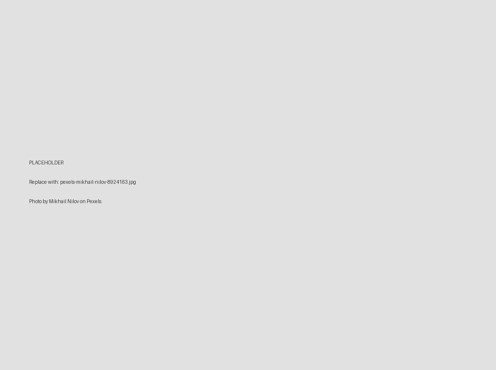
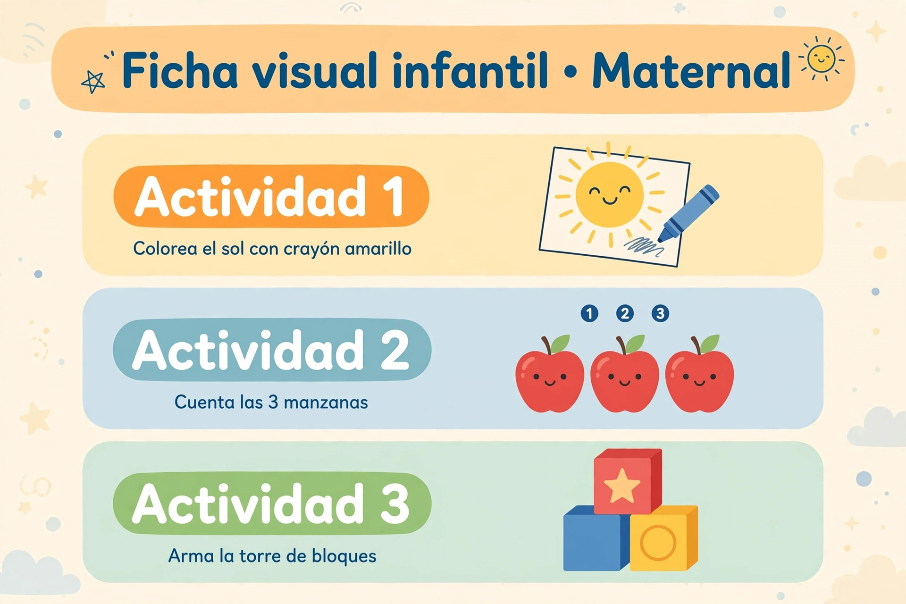

[English version](README.md)

# AulaScout - De foto + voz a planeación para docentes de 0 a 3 años


- **Demo en vivo:** https://aulascout-demo-389771440223.us-central1.run.app
- **Video demo:** https://youtube.com/shorts/QXHt04EsUCI?si=Bl8jgcUUI2qKFT-5 *(provisional; se cambiará por el video horizontal final)*

Hackathon: Meta Global AI 2026 - pista Indie developer, *Build for Your World*.

## Qué es

La docente toma **una foto del salón (sin niñas ni niños)** y graba una **nota de voz de 15-20 segundos** diciendo qué materiales tiene (y cuáles no). AulaScout lo convierte en:

1. un inventario de los materiales disponibles,
2. una **planeación de 3 actividades de 20 minutos, con sección de Seguridad en cada una**,
3. una **ficha visual de 3 paneles** para imprimir o mostrar.

Está pensado para el contexto de la SEP *Fase 1* (lactantes / maternal), niñas y niños de **18 a 36 meses**. Las planeaciones las genera un modelo; no son documentos oficiales de la SEP.

## Cómo funciona

| Paso | Modelo (todo vía `api.meta.ai/v1`) | Qué hace |
|---|---|---|
| 1 | **SAM 3.1** | Detecta los materiales en la foto. Una petición por concepto, con conceptos en **inglés** (p. ej. `mat`, `wooden blocks`, `white trays`); en nuestras pruebas los conceptos en español dieron 0 detecciones. Cajas + máscaras. |
| 2 | **Muse Voice Transcribe 1.0** | Transcribe la nota de voz; separa materiales afirmados y negados ("no tengo libros de tela"). |
| 3 | **Muse Spark 1.3** | Escribe la planeación 3x20 min, Seguridad x3, edad 18-36 meses, a partir del inventario. |
| 4 | **Muse Image 1.0** | Dibuja la ficha de 3 paneles a partir de los 3 títulos de actividad. |

La web es asíncrona: `POST /api/generar` devuelve un `job_id` al instante y el navegador consulta `GET /api/status/<job_id>` (una corrida completa tarda ~1-2 minutos).

## Ejemplo

Ejemplo 2 del demo (ver [`docs/examples/`](docs/examples/)):

**Foto** (Photo by Mikhail Nilov on Pexels):



> El archivo de arriba es por ahora un **placeholder**; la foto real se agrega en `docs/examples/example-2-shelf.jpg`. Ver [`docs/examples/README.md`](docs/examples/README.md).

**Transcripción de la nota de voz:**

> Tengo estante bajo, charolas blancas, libros de tela, botellas sensoriales y bloques en canastas. No tengo tapete de foamy.

**Ficha generada** (salida real del pipeline para esta nota de voz, hecha con nuestra propia foto de prueba del salón, no con la de Pexels):



## Cómo ejecutarlo

Requisitos: Python 3.10+, `ffmpeg` (convierte el audio a WAV 16 kHz) y una API key de Meta Model API.

```bash
cp .env.example .env                 # luego edita .env y pon MODEL_API_KEY
python3 -m venv .venv && source .venv/bin/activate
pip install -r requirements-web.txt
python web/app.py                    # http://127.0.0.1:5000
```

Variables de entorno (ver `.env.example`; no se sube ningún valor real):

| Variable | Obligatoria | Significado |
|---|---|---|
| `MODEL_API_KEY` | sí | API key de Meta Model API. Vive solo en el servidor; el navegador nunca la ve. |
| `META_API_BASE_URL` | no | Por defecto `https://api.meta.ai/v1`. |
| `PORT`, `RUNS_WEB` | no | Puerto local (5000 por defecto) y carpeta de corridas (`/tmp/runs/web` por defecto). |

Demo por línea de comandos (una corrida, escribe en `out/`): `python demo.py --foto salon.jpg --salida out/`

Despliegue en Google Cloud Run (Dockerfile en la raíz; la key viene de Secret Manager):

```bash
gcloud run deploy aulascout-demo --source . --region us-central1 --allow-unauthenticated \
  --memory 1Gi --cpu 1 --no-cpu-throttling --timeout 300 --max-instances 1 --concurrency 10 \
  --set-secrets MODEL_API_KEY=MODEL_API_KEY:latest
```

La demo pública tiene tope (5 corridas por hora por IP, 20 por día en total) porque cada corrida gasta créditos de los modelos.

## Seguridad

- **Solo planeación educativa. No es consejo médico.**
- **La foto no debe incluir niñas ni niños.** Usa una foto del salón vacío.
- Cada actividad incluye una sección de Seguridad (piezas pequeñas, supervisión), pero la docente siempre debe revisar la planeación antes de usarla con los niños.

## Limitaciones

Preferimos ser explícitos sobre lo que todavía no funciona bien:

- **Spark a veces ignora las negaciones.** Si la nota de voz dice que un material *no* está disponible (p. ej. "no tengo libros de tela"), la planeación aún puede usarlo (observamos `fabric_books` en la actividad 3 aunque la docente dijo que no los tenía). La negación queda registrada en el inventario, pero la planeación no siempre la respeta.
- **La transcripción de voz puede variar con la misma nota.** Correr el mismo audio dos veces puede dar texto ligeramente distinto (acentos, puntuación, grafías como "foami"/"foamy", palabras ocasionalmente confusas).
- **El análisis de negaciones es simple.** La separación afirmado/negado es por oración; una oración unida por coma ("tengo X, pero no tengo Y") puede marcar también X como negado. Lo observamos una vez.
- **Spark puede truncarse.** A veces Spark se detiene por longitud antes de terminar; el pipeline reintenta hasta 3 veces y la versión web usa un presupuesto de tokens mayor.
- **Los títulos de la ficha son genéricos** ("Actividad 1/2/3") y las ilustraciones son genéricas, no un dibujo de tu salón real.
- **SAM 3.1 es sensible a la redacción del concepto** (en inglés funciona; en español dio 0 detecciones en nuestras pruebas) y algunos objetos devuelven 0 detecciones.
- **La demo no tiene login.** Es pública y solo la protegen topes de uso; el tope por IP es de mejor esfuerzo. Los topes se reinician si el servidor se reinicia.

## Estructura

```text
web/               # app Flask (trabajos asíncronos) + pipeline de la web
src/               # config, voz, helpers de SAM / Spark / Image
runs/002/{A,B}/    # parser SAM y helpers de prompts que reusa el pipeline web
docs/              # guion de la demo y ejemplos
Dockerfile         # imagen de Cloud Run (raíz del repo como contexto)
```

## Créditos

- **Meta Model API** - SAM 3.1, Muse Voice Transcribe 1.0, Muse Spark 1.3, Muse Image 1.0.
- Foto de ejemplo: **Photo by Mikhail Nilov on Pexels**.
- Hecho por Alvaro Miguel Toriz Proenza. Licencia [MIT](LICENSE).
