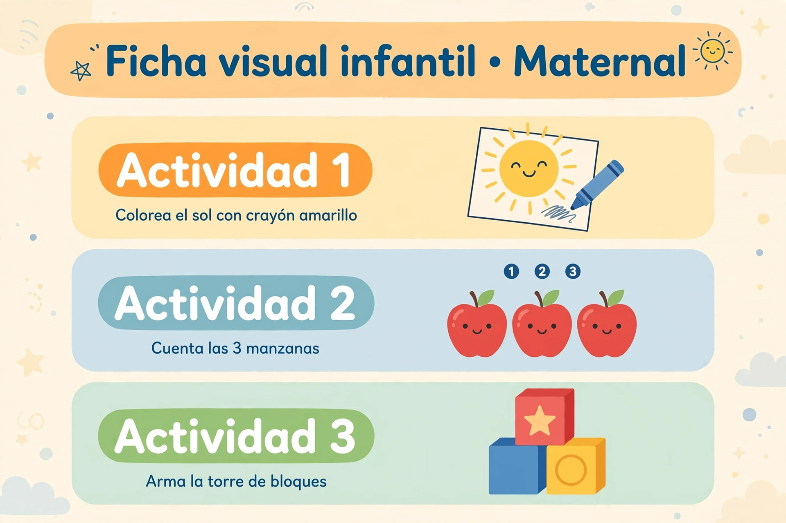

[Versión en español](README.es.md)

# AulaScout - Photo + voice to lesson plan for infant teachers (0-3)


- **Live Demo:** https://aulascout-demo-389771440223.us-central1.run.app
- **Demo Video:** https://youtube.com/shorts/QXHt04EsUCI?si=Bl8jgcUUI2qKFT-5 *(placeholder; will be replaced by the final horizontal video)*

Hackathon: Meta Global AI 2026 - Indie developer track, *Build for Your World*.

## What it is

A teacher takes **one photo of the classroom (no children in it)** and records a **15-20 second voice note** saying what materials they have (and what they don't). AulaScout turns that into:

1. an inventory of the available materials,
2. a **3-activity lesson plan, 20 minutes each, with a Safety section in every activity**,
3. a **3-panel visual card** (ficha) to print or show.

It is designed for the Mexican SEP *Fase 1* context (lactantes / maternal), children **18-36 months**. The plans are generated by a model; they are not official SEP documents.

## How it works

| Step | Model (all via `api.meta.ai/v1`) | What it does |
|---|---|---|
| 1 | **SAM 3.1** | Detects the materials in the photo. One request per concept, concepts written in **English** (e.g. `mat`, `wooden blocks`, `white trays`); Spanish concepts returned 0 detections in our tests. Boxes + masks. |
| 2 | **Muse Voice Transcribe 1.0** | Transcribes the voice note; affirmed and negated materials ("I don't have fabric books") are separated. |
| 3 | **Muse Spark 1.3** | Writes the 3x20 min plan, Safety x3, ages 18-36 months, using the inventory. |
| 4 | **Muse Image 1.0** | Draws the 3-panel visual card from the 3 activity titles. |

The web app is asynchronous: `POST /api/generar` returns a `job_id` immediately and the browser polls `GET /api/status/<job_id>` (a full run takes about 1-2 minutes).

## Example

Example 2 of the demo (see [`docs/examples/`](docs/examples/)):

**Photo** (Photo by Mikhail Nilov on Pexels):


> The file above is currently a **placeholder**; the real photo is added to `docs/examples/example-2-shelf.jpg`. See [`docs/examples/README.md`](docs/examples/README.md).

**Voice note transcription:**

> Tengo estante bajo, charolas blancas, libros de tela, botellas sensoriales y bloques en canastas. No tengo tapete de foamy.

**Generated card** (real output of the pipeline for this voice note, produced with our own test classroom photo, not the Pexels one):



## How to run

Requirements: Python 3.10+, `ffmpeg` (used to convert audio to 16 kHz WAV), and a Meta Model API key.

```bash
cp .env.example .env                 # then edit .env and set MODEL_API_KEY
python3 -m venv .venv && source .venv/bin/activate
pip install -r requirements-web.txt
python web/app.py                    # http://127.0.0.1:5000
```

Environment variables (see `.env.example`, no real values are committed):

| Variable | Required | Meaning |
|---|---|---|
| `MODEL_API_KEY` | yes | Meta Model API key. Lives only on the server; the browser never sees it. |
| `META_API_BASE_URL` | no | Defaults to `https://api.meta.ai/v1`. |
| `PORT`, `RUNS_WEB` | no | Local port (default 5000) and where runs are written (default `/tmp/runs/web`). |

Command-line demo (single run, writes to `out/`): `python demo.py --foto salon.jpg --salida out/`

Deploy to Google Cloud Run (Dockerfile at the repo root; the key comes from Secret Manager):

```bash
gcloud run deploy aulascout-demo --source . --region us-central1 --allow-unauthenticated \
  --memory 1Gi --cpu 1 --no-cpu-throttling --timeout 300 --max-instances 1 --concurrency 10 \
  --set-secrets MODEL_API_KEY=MODEL_API_KEY:latest
```

The public demo is capped (5 runs per hour per IP, 20 per day overall) because every run spends model credits.

## Safety

- **Educational planning only. This is not medical advice.**
- **The photo must not include children.** Use a photo of the empty classroom.
- Every activity includes a Safety section (small parts, supervision), but a teacher must always review the plan before using it with children.

## Limitations

We prefer to be explicit about what does not work well yet:

- **Spark sometimes ignores negations.** If the voice note says a material is *not* available (e.g. "I don't have fabric books"), the plan can still use it (we observed `fabric_books` being used in activity 3 even though the teacher said they had none). The negation is recorded in the inventory but not reliably respected by the plan.
- **Voice transcription can vary on the same note.** Running the same audio twice can give slightly different text (accents, punctuation, spelling such as "foami"/"foamy", occasionally garbled words).
- **Negation parsing is simple.** The affirmed/negated split is by sentence; a comma-joined sentence ("I have X, but I don't have Y") can mark X as negated too. We observed this once.
- **Spark can be truncated.** Spark sometimes stops by length before finishing; the pipeline retries up to 3 times and the web version uses a larger token budget.
- **Card titles are generic** ("Actividad 1/2/3") and the illustrations are generic, not a rendering of your actual classroom.
- **SAM 3.1 is sensitive to the wording of the concept** (English works, Spanish returned 0 detections in our tests) and some objects return 0 detections.
- **No login on the demo.** It is public and only protected by usage caps; the per-IP cap is best-effort. The caps reset if the server restarts.

## Project layout

```text
web/               # Flask app (async jobs) + pipeline used by the web demo
src/               # config, voice, SAM / Spark / Image helpers
runs/002/{A,B}/    # SAM parser and prompt helpers reused by the web pipeline
docs/              # demo script and examples
Dockerfile         # Cloud Run image (repo root as build context)
```

## Credits

- **Meta Model API** - SAM 3.1, Muse Voice Transcribe 1.0, Muse Spark 1.3, Muse Image 1.0.
- Example photo: **Photo by Mikhail Nilov on Pexels**.
- Built by Alvaro Miguel Toriz Proenza. Licensed under the [MIT License](LICENSE).
